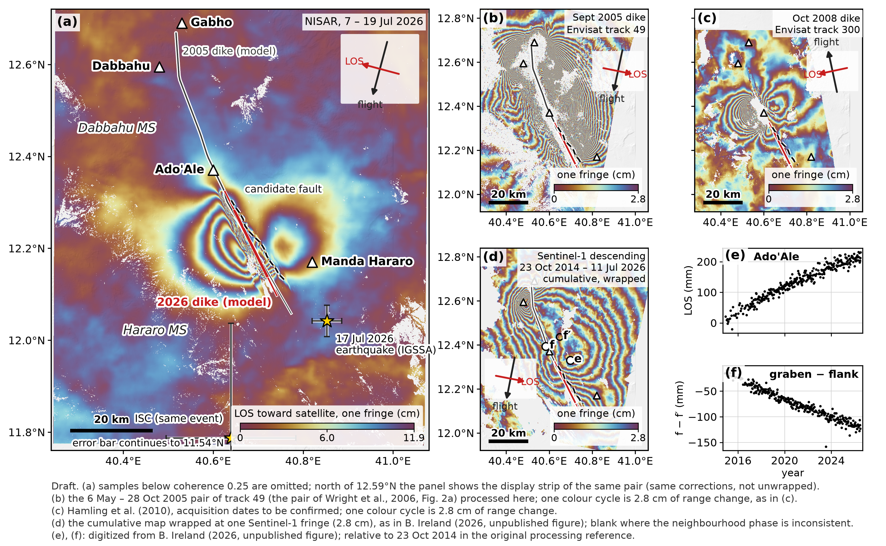
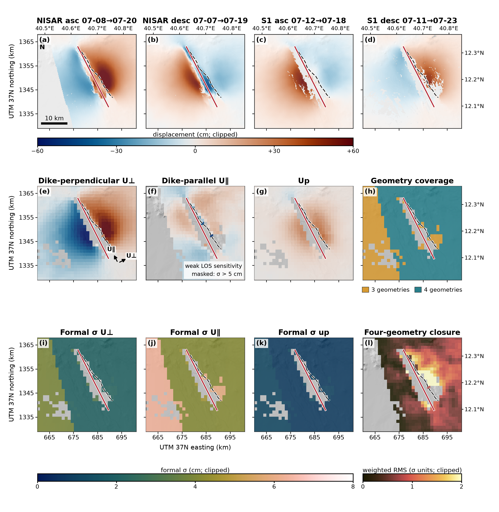
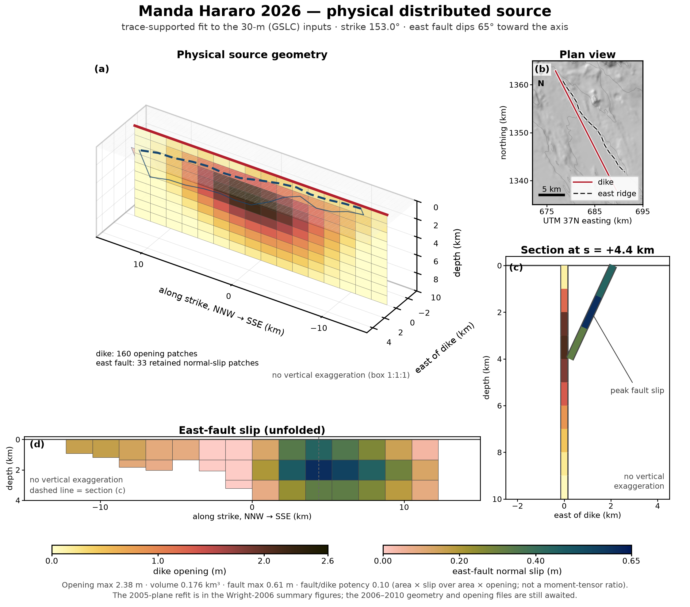
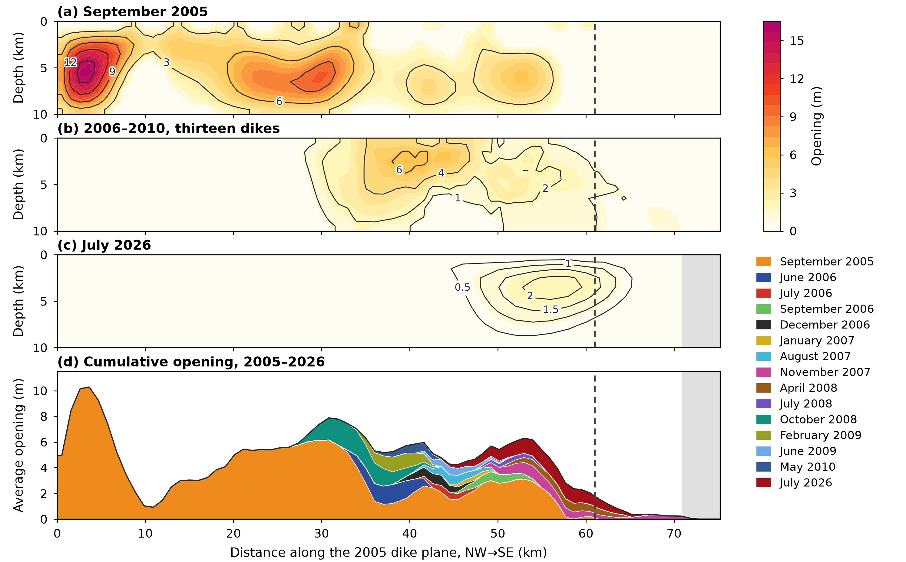

# Manda Hararo 2026

Code, results and inputs behind the analysis of the dyke that intruded the
Dabbahu–Manda Hararo rift segment, Afar, Ethiopia, on 16–17 July 2026: NISAR
L-band and Sentinel-1 C-band interferometry, a uniform and a distributed dyke
and fault model, the displacement decomposition, timing and post-intrusion
checks, and the figures of the paper "Dabbahu–Manda Hararo reawakening"
(Pai et al., in preparation for *Geophysical Research Letters*).

Zenodo: software DOI [to be added]; data DOI [to be added].

Maintainer: Vinay Pai, Yowon Labs, <vinay@yowon.org>.

## Key results

| Quantity | Value | Where |
|---|---|---|
| Co-event line-of-sight maxima | +76.6 cm ascending, +58.2 cm descending | `results/los_summary.md` |
| Onset | after 15 July, present by 18 July 2026 | `results/los_summary.md`, `results/probe_history.md` |
| Distributed model used in the paper (opening on the dyke plane with slip on a candidate east graben fault, 30-m NISAR inputs) | 0.176 km³, peak opening 2.38 m, joint RMS 2.55 cm; fault slip up to 0.61 m, conditional on the assumed trace | `results/distributed_fit_mapped_gslc.md` |
| Uniform dyke | strike 153°, length 17.3 km, depth 1.3–5.9 km, opening 2.32 m, 0.187 km³ | `results/okada_fit.md`, `results/model_sensitivity.md` |
| Sentinel-1 cross-check of the NISAR model | r = 0.974 ascending, 0.933 descending | `results/s1_crosscheck.md`, `results/s1_tracks.md` |
| Post-event motion with the dyke pattern, as a fraction of the co-event signal | 0.107 in the NISAR pair 19 July–12 August; 0.140 (ascending) and 0.053 (descending) in the first Sentinel-1 windows; an exponential fit to six windows gives a 4.3-day decay time, with no formal uncertainty | `results/continuation.md`, `results/s1_tracks.md` |
| Pre-event NISAR windows | sixteen windows, November 2025 to 15 July 2026; the largest absolute 1-km probe mean is 3.4 cm | `results/probe_history.md` |
| 2005–2010 openings against 2026 | the 2026 dyke lies in the part of the plane where the 2006–2010 dykes added the least opening | `results/opening_history.md`, `results/uperp_three_epoch.md` |

Each report in `results/` states its inputs, settings and limits;
[`LIMITATIONS.md`](LIMITATIONS.md) states what each number does and does not
establish.

## Figures



Figure 1 (draft): the segment and the July 2026 intrusion in the NISAR
interferogram, the September 2005 dyke in the Envisat track-49 pair
processed here, the October 2008 dyke in Envisat track 300, and the
Sentinel-1 cumulative displacement of 2014–2026 wrapped at one fringe
(`python -m mh26.figure1`; the strip north of the NISAR analysis crop
comes from `python -m mh26.gslc_strip`, the 2005 interferogram from
`python -m mh26.envisat_2005`).



Displacement decomposition: opening-perpendicular, along-dyke and vertical
displacement from the two NISAR and two Sentinel-1 geometries
(`python -m mh26.summary_figures`).



The dyke and fault model: distributed opening on the dyke plane and slip on
the candidate east graben fault, with the observed, modelled and residual
fields (`python -m mh26.summary_figures`).



Opening in three epochs: September 2005, the cumulative 2006–2010 sequence
and July 2026 on the same section of the rift, with the depth-averaged
profiles (`python -m mh26.opening_history`). The manuscript layout above (Figure 4 of the letter, two columns wide) carries its notes in its caption, `results/opening_history_manuscript_gslc_caption.txt`, written from the same numbers; `results/opening_history_common_scale_gslc.png` is the annotated version.

More figures, mostly for the supplement: the rewrapped data–model–residual
panels (`results/summary_los_model_residual.png`), the loop-closure check
(`results/loop_closure_nisar.png`), the fault depth sweep
(`results/fault_depth_mapped_gslc.png`), the post-event decay fit
(`results/decay_fit_windows.png`), the phase-gradient ridges that locate the
fault (`results/summary_phase_gradient.png`), the stress change on the fault
(`results/summary_fault_stress.png`) and the along-rift flank averages
(`results/along_rift_halves_gslc.png`).

## Reproduce

```bash
python3 -m venv .venv && source .venv/bin/activate
python -m pip install -r requirements-lock.txt
# unpack the data archives into data/ as described in data/README.md
python -m mh26.validate --profile full
```

The validation profile recomputes the committed results from the data
archives and compares them with the stored checksums. To rerun the analysis
step by step, follow the processing order in
[`ANALYSIS_GUIDE.md`](ANALYSIS_GUIDE.md); `requirements-lock.txt` is the
environment the committed outputs were made with.

## Data

- The data record holds the NISAR GUNW crops, the reprocessed 30-m NISAR
  interferograms and unwrapped fields, the loop-closure inputs, the analysis
  GeoTIFFs and the LiCSAR Sentinel-1 pairs, each archive with a SHA-256
  manifest. Layout, verification and rebuild instructions:
  [`data/README.md`](data/README.md).
- Contributed inputs, credited to their authors: the
  2005–2010 dyke opening models and the Envisat track-300 interferograms of
  Hamling et al. (2009, 2010) (`data/ihamling/`); the 2005 dyke plane of
  Wright et al. (2006) (`data/complex_geom2_revised_test.dat`); the
  Sentinel-1 cumulative displacement maps of Pedro Espín Bedón and Ben
  Ireland (`data/sentinel1-cumulative/`); and the site series digitized from
  Ben Ireland's figure (`data/ireland-series/`).
- The wrapped Envisat track-49 interferogram of the September 2005 dyke,
  processed here from the ESA archive products (`data/envisat-2005/`).
- Sources: NISAR L2 GSLC and GUNW provisional products, NASA/JPL via ASF DAAC
  (10.5067/NIL2GSLC-P1, 10.5067/NIL1GUNW-P1); Sentinel-1 interferograms from
  COMET LiCSAR under the [portal's conditions](https://comet.nerc.ac.uk/COMET-LiCS-portal/);
  Copernicus GLO-30 terrain for the figures; Envisat ASAR data © ESA.

## Documents

- [`ANALYSIS_GUIDE.md`](ANALYSIS_GUIDE.md): what each step does, in processing order, and the code map.
- [`PROCESSING_NOTES.md`](PROCESSING_NOTES.md): the conventions and choices that affect the numbers.
- [`LIMITATIONS.md`](LIMITATIONS.md): what the results do and do not establish.
- [`data/README.md`](data/README.md): archives, checksums, contributed inputs.
- [`CHANGELOG.md`](CHANGELOG.md): releases, the commit history by day, and the former README's analysis notes.

## Licence and citation

The code is released under the MIT licence (`LICENSE`); the data record under
CC BY 4.0. The contributed inputs remain their authors' and are cited to
their papers. Cite the Zenodo records (DOIs above) and the paper.
